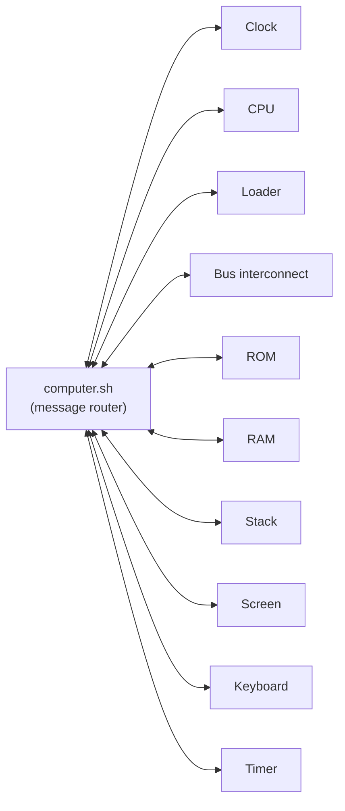

# Bashputer

## AI Usage

All code in this repository was written by Andrew Masker unless otherwise stated. The exceptions are marked in each file's header:

| File | Author |
| --- | --- |
| [`Assembler/Examples/FastSnake.bassm`](Assembler/Examples/FastSnake.bassm) | Andrew Masker and Claude Opus 5.5 |
| [`Assembler/Examples/Hanoi.bassm`](Assembler/Examples/Hanoi.bassm) | Claude Opus 5.5 |
| [`Assembler/Examples/Maze.bassm`](Assembler/Examples/Maze.bassm) | Claude Opus 5.5 |
| [`Assembler/Examples/Pong.bassm`](Assembler/Examples/Pong.bassm) | Claude Opus 5.5, modelled on Andrew Masker's `Snake.bassm` |
| [`Assembler/Examples/Showcase.bassm`](Assembler/Examples/Showcase.bassm) | Claude Opus 5.5 |

The cartridges with the same names in `src/Cartridges/` are assembled from these files.

AI was also used for:

- **Research:** exploring design options and how Bash and terminals behave.
- **Debugging and code review:** tracing bugs, reviewing changes, and suggesting fixes.
- **Testing and profiling:** running programs in throwaway test harnesses and measuring bus cycles.
- **Learning:** explaining concepts, including a walkthrough of the TextMate grammars used by the VS Code extension.
- **Documentation:** this README and the [`docs/`](docs/) folder were written by Claude Opus 5.5.

## What is Bashputer?

Bashputer is a 64-bit computer built entirely in Bash. The CPU, memory, bus, screen, keyboard, timer, and cartridge loader each run as their own Bash process and talk to each other over named pipes, much like chips talking over wires. It has its own instruction set, an assembler also written in Bash, and a library of programs that includes Snake and Pong.

| Part | Details |
| --- | --- |
| CPU | 64-bit, little-endian, 256 general-purpose registers, 66 instructions |
| Memory | 64,000 bytes of ROM, 1,024,000 bytes of RAM, 1,024,000 bytes of stack |
| Screen | Drawn in your terminal, up to 254 × 127 character cells, or 254 × 254 pixels using half-block characters, in 256-color or 24-bit color |
| Input | Polled keyboard |
| Other devices | Millisecond timer, cartridge loader with persistent storage |
| Software | `.bassm` assembly language with macros, scoped labels, and compile-time arithmetic |

## Quick start

You need:

- Linux
- Bash 5.0 or newer
- [bubblewrap](https://github.com/containers/bubblewrap) (`bwrap`), which `run.sh` uses to sandbox the computer
- GNU coreutils 8.31 or newer
- A UTF-8 terminal with 256-color support (24-bit color is needed for programs that use RGB)

Then clone the repository and start a cartridge:

```bash
git clone https://github.com/AndrewMasker/Bashputer.git
cd Bashputer
src/run.sh Snake
```

Press `Ctrl-C` to stop the computer at any time.

## Included programs

Each program is ready to run with `src/run.sh <Cartridge>`. The source is in [`Assembler/Examples/`](Assembler/Examples/).

| Cartridge | What it does | Controls |
| --- | --- | --- |
| `Fibonacci` | Prints Fibonacci numbers in hexadecimal | None |
| `Hanoi` | Solves the Towers of Hanoi with 4 disks, one move per line | None |
| `Showcase` | Tours the assembly language and prints the result of each demo | Type to echo, `q` to quit |
| `Snake` | The classic game | `w` `a` `s` `d` to steer, `q` to quit |
| `FastSnake` | Snake rebuilt to use as few bus cycles as possible | `w` `a` `s` `d` to steer, `q` to quit |
| `Pong` | Two-player Pong, first to 7 points | `w` `s` for the left paddle, `i` `k` for the right, `space` to play again, `q` to quit |
| `Maze` | Generates endless rainbow mazes | `Ctrl-C` to quit |

## Writing a program

Write a `.bassm` file, assemble it into a cartridge, and run it:

```bash
bash Assembler/assembler.sh MyProgram.bassm -o src/Cartridges/MyProgram
src/run.sh MyProgram
```

The [assembly language guide](docs/assembly-language.md) starts with a complete example program.

## How it works

`computer.sh` starts every component as a separate process and connects to each one with a pair of named pipes. On every clock cycle it ticks the CPU and the loader, then routes their memory requests through the bus interconnect to the right device.



The [architecture guide](docs/architecture.md) follows a memory access through the system step by step.

## Documentation

| Guide | Covers |
| --- | --- |
| [Architecture](docs/architecture.md) | Processes, the clock cycle, bus requests, CPU internals, and error handling |
| [Instruction set](docs/instruction-set.md) | Registers, encoding, and every instruction with its bus-cycle cost |
| [Memory map and devices](docs/memory-map.md) | The address space and the registers of each device |
| [Assembly language](docs/assembly-language.md) | The `.bassm` language, the assembler, and editor support |
| [Cartridges](docs/cartridges.md) | The cartridge file format and how cartridges are loaded |
| [Message protocol](src/message_protocol.md) | The messages components send each other |

## Project layout

```text
.
├── Assembler/
│   ├── assembler.sh            Assembler entry point
│   ├── opcodes.sh              Instruction table
│   ├── stages/                 Preprocessor, processor, and hexer
│   ├── Examples/               Example programs
│   └── Assembly Extension/     VS Code syntax highlighting
├── docs/                       Project documentation
└── src/
    ├── run.sh                  Starts the computer in a sandbox
    ├── message_protocol.md     Component message reference
    ├── Computer/               Component startup and message routing
    ├── Components/             CPU, bus, clock, RAM, screen, keyboard, timer, and loader
    └── Cartridges/             Assembled programs
```

## Troubleshooting

| Problem | Fix |
| --- | --- |
| `run.sh: bwrap not found` | Install bubblewrap, for example with `sudo apt install bubblewrap`. |
| `computer.sh: No such file or directory` | Move the repository out of `/tmp`. The sandbox mounts an empty `/tmp`, which hides anything stored there. |
| `bwrap` reports a permissions error | Your distribution may restrict unprivileged user namespaces, which bubblewrap needs. |
| `'<name>' was not found` | Check that `src/Cartridges/<name>/hex` exists. Cartridge names are case-sensitive. |
| The display looks scrambled | Make the terminal window larger, and check that it supports UTF-8 and 256 colors. |
